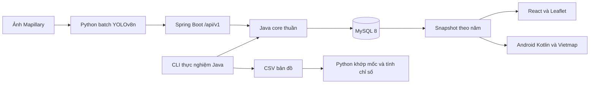

# Phạm vi LiveSign

## Mục tiêu

Một người vận hành hệ thống nhận diện biển báo và cập nhật bản đồ theo năm từ ảnh Mapillary công khai.
MVP dùng một tuyến khoảng 1.500 m ở lõi Hoàn Kiếm, cho các năm 2023, 2024 và 2025.
Mỗi biển phải truy được ảnh, người chụp, năm, cấu hình và run.

Ba luồng sản phẩm:

1. Đọc snapshot bản đồ theo năm. Cutoff là `captured_at < 01-01 năm sau 00:00:00 UTC`.
2. Chọn xe, năm và chuyến để phát lại. Banner và TTS xuất hiện trước khi gặp biển ít nhất 5 s; có log thời gian.
3. Admin xem bằng chứng mâu thuẫn và quyết định confirm/keep/remove/replace/defer. Có version và history.

## Công nghệ đã chọn

Core Java chỉ viết một lần. Core xử lý gom lần thấy, giao tia, fallback vị trí, hướng mặt, gộp, điểm Beta giảm theo tuổi và vòng đời.
Backend và CLI cùng gọi core. Không viết lại thuật toán này bằng Python hay Kotlin.
Các hàm Python hiện tại chỉ phục vụ khảo sát, đọc nguồn, bbox detector và chuẩn bị dữ liệu gán tay.

Backend một khối: Spring Boot, JWT, bcrypt, role user/importer/admin, MySQL 8 với POINT SRID 4326 và SPATIAL index.
Snapshot dựng sẵn. API bản đồ chỉ đọc run ready; run cũ có thể superseded.
Android dùng Vietmap và map matching cả trace một lần, lọc phía trước cục bộ, TTS, TFLite và log thiết bị thật.
Web admin dùng React và Leaflet.

## Các cổng kiểm

| Giai đoạn | Điều kiện qua |
|---|---|
| 0. Khảo sát | Có số đo thật, crop và đối chiếu nhãn; đủ dữ liệu hai phía; người dùng duyệt tuyến và 10–15 mã |
| 1. Hợp đồng | Observation, API, schema DB, model, classes, trip trace và ground truth; ngưỡng có status |
| 2. Dữ liệu và AI | Giấy phép rõ; lọc trùng trước chia; nhãn không lẫn; train/val/test theo nhóm; test Hà Nội độc lập; TFLite và parity |
| 3. Core và backend | Unit test bắt buộc; import idempotent ≤500 dòng; snapshot và admin expected_version; auth ba role |
| 4. Dữ liệu thật | Corpus khóa hash; snapshot ready cho cả ba năm; count cặp và hướng trên chính tuyến |
| 5. Android và admin | Phát lại đủ năm; banner/TTS đúng xe; đối chiếu ahead; ≥3 lượt đo trên máy thật |
| 6. Thực nghiệm | PB/B0/B1/B2/B3 × năm × pre/post, hoặc lý do not_run; cùng core và hash đầu vào |

B3 chỉ xét sau bài thử ảnh nhìn rõ có nhãn độc lập. Mức 30–<50% giữ tắt và cần đo thêm.
Bật bằng chứng âm, chốt tuyến, chốt lớp và dùng dataset giấy phép chưa rõ đều cần người dùng quyết định.

## Trạng thái

Đang ở Giai đoạn 0. Chưa có model LiveSign đã train, backend, snapshot ready hay bản Android để đo trên máy thật.
Khi tới Giai đoạn 2, chuẩn bị notebook Colab và hướng dẫn người dùng chạy YOLOv8n: imgsz 640, fliplr 0, seed cố định, chọn checkpoint bằng val.
Windows dùng workers 0. Không thực hiện train tốn tài nguyên trước khi thông báo và hướng dẫn người dùng.
